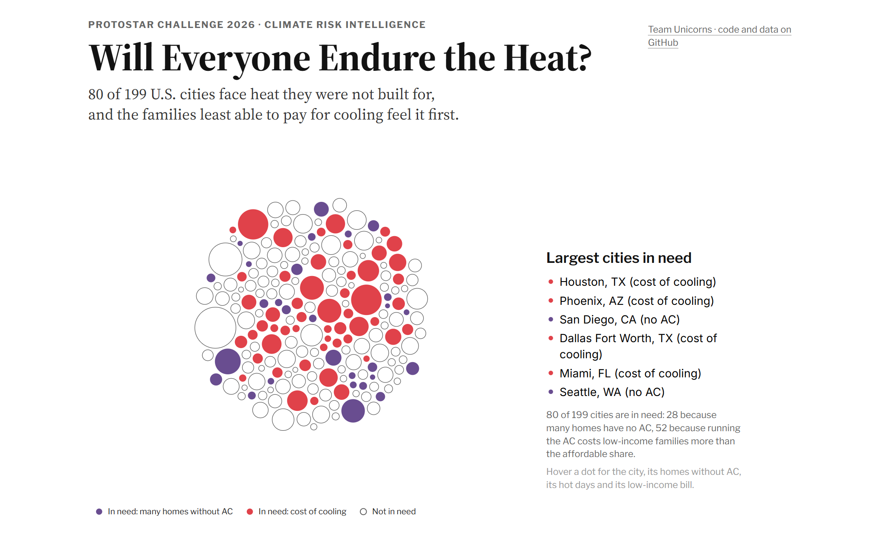
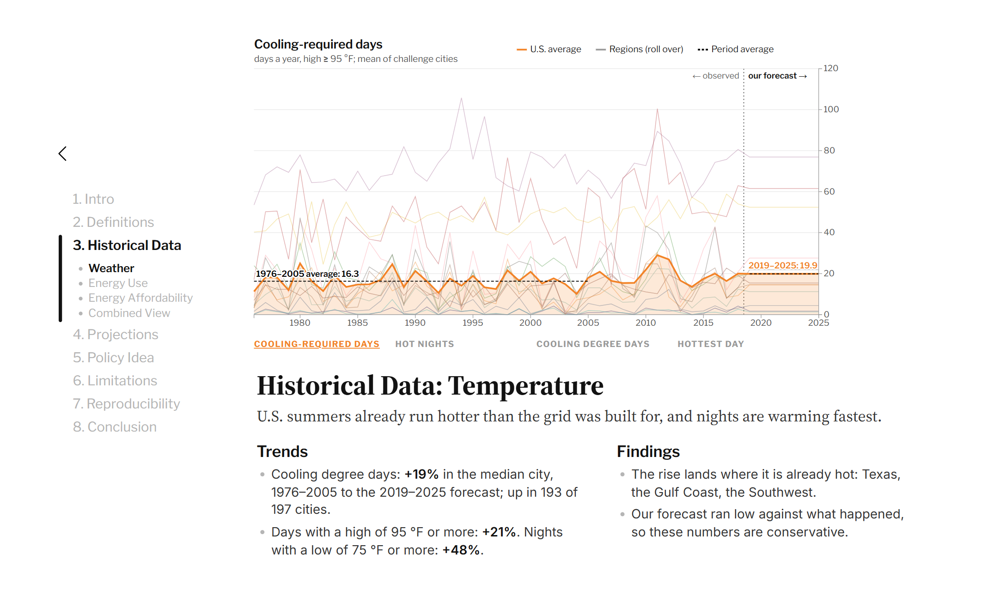

# Protostar Challenge: Climate Risk Intelligence (CMU 2026)

Negative result: no

Links: [submission template](https://huggingface.co/datasets/CMU-OSPO/protostar-climate-submission-template) · [challenge Space](https://huggingface.co/spaces/CMU-OSPO/protostar-challenge-climate-risk-intelligence)

`submission.csv` holds our forecasts: 210 cities × 7 years (2019-2025) × 4 metrics = 5,880 rows. It is the Experiment 5B forecast, frozen in commit `0fbbe5b8eaa0567dbb1bcdfa247eefcae1282e5d`. (Earlier submissions: Experiment 5, frozen in `caccb0427a8821fe44c9e36767586e780cd1fb85`; Experiment 3, frozen in `295c10ab5e8eeb4e81b116688f3632ade49366d7`.)

## Presentation: *Will Everyone Endure the Heat?*

**Deck: [`index.html`](index.html)** (repo root; its styles, scripts and data are in `presentation/`), a web slide deck for the Policy Idea, built from this repository's outputs (data up to 2018 plus our forecast) - scroll down for the full show!




To open it, clone or download the repository, then either:

- double-click `index.html` (it opens in any modern browser; an internet connection loads the fonts and the D3 chart library), or
- serve it locally: `python -m http.server 8765`, then open <http://localhost:8765>.

Use the arrow keys, Page Up/Down or the scroll wheel to move; the side list jumps between sections. Each section has its own link:

| # | Section | Opens at |
|---|---|---|
| 1 | Intro: the cities in need | `index.html#intro` |
| 2 | Definitions: affordable and livable | `#definitions` |
| 3 | Historical data: weather, energy use, affordability, combined view | `#weather`, `#energy-use`, `#affordability`, `#synthesis` |
| 4 | Projections, 2019-2025: national numbers and regional affordability | `#projected`, `#projections` |
| 5 | Policy idea: plan on the weather that's coming | `#policy` |
| 6 | Limitations | `#limitations` |
| 7 | Reproducibility | `#reproducibility` |
| 8 | Conclusion | `#conclusion` |

The deck's data file is rebuilt by `python code/export_deck_data.py` (after the `code/policy_grid_*.py` scripts). The full reasoning, with every source, is the essay outline [`docs/policy_essay_outline.md`](docs/policy_essay_outline.md).

## Method (current submission: Experiment 5B)

Experiment 5B is Experiment 5 (next section) plus two candidates built from each city's **daily** highs and lows (the challenge's `daily` table, up to 2018). Everything else is unchanged: Experiment 5's candidates, the held-back origins 1998, 2004 and 2011, and the decision rule; the new candidates count as more complex than all of Experiment 5's for the 0.01 tie rule. `outputs/exp05b/decision.json` was written before the final forecast.

1. **cdd from daily highs and lows (chosen).** cdd sums `max(0, (Tmax + Tmin)/2 - 65)` over days, so the same warming adds many degree days in Miami and almost none in Eureka. Experiment 5 adds one cdd slope to every city. Experiment 5B instead takes the city's actual days from its last 10 valid cdd years, warms every daily high by the shared slope of annual mean Tmax (+0.035 °F/yr at origin 2018) and every daily low by the shared slope of annual mean Tmin (+0.047 °F/yr; nights warm faster), times (year - those years' middle year), and recomputes cdd. With no warming this equals Experiment 5's 10-year level, so the only change is how warming turns into cdd. A 15-year version was also tested.
2. **Hottest day from the 95th percentile of daily highs (not chosen).** The single hottest day is noisy, so we used the shared slope of each year's 95th-percentile daily high (much steadier) with a 30- or 15-year level. It did not beat the plain average (-0.007 and -0.011). The daily data shows why: the hot tail of daily highs barely moved before 2018 (shared slope -0.005 to +0.014 °F/yr depending on origin), while mean highs and especially lows rose. `outputs/exp05b/slopes.csv`.

| Metric | Method used | Held-back skill: chosen (Exp05's pick) | Per origin 1998 / 2004 / 2011 |
|---|---|---|---|
| `annual_avg_temp` | 15-year level + shared slope (as Exp05) | +0.177 | 0.196 / 0.167 / 0.169 |
| `cdd` | **daily delta method, last 10 years** | +0.126 (+0.112) | -0.003 / 0.139 / 0.244 |
| `total_precip_in` | A plain average (as Exp05) | 0 | nothing beat the plain average |
| `hottest_day_temp` | A plain average (as Exp05) | 0 | nothing beat the plain average |

The cdd choice is not uniform: the delta method loses to Exp05's pick at origin 1998 (-0.003 vs +0.022) and wins at 2004 and 2011. Its forecast differs most where a single slope fits worst: cool coastal cities drop to near zero (e.g., `USW00024213` from about 80 to 4 cdd), and the hottest cities rise about 2%. Code: `code/exp05b_daily_distribution.py`; outputs: `outputs/exp05b/`.

**Bug fix in the held-back test (2026-11-08).** `shared.valid_flags` subtracted a merged column with a fresh 0..n-1 index from a column that kept the data's own index. When the data is cut at a held-back origin the two no longer line up, so about one cdd validity flag in four in the 30-year windows was wrong (1,725 of 6,300 at origin 1998; 0 at origin 2018). The fix (`.to_numpy()`) leaves every submitted forecast unchanged, since those use origin 2018, and Experiment 5's picks are the same with it, but its cdd held-back skill is +0.112, not the +0.086 in `outputs/exp05/`. The held-back cdd numbers in `outputs/exp03/` to `outputs/exp07/` were made before the fix and are not regenerated; rerun with the fix, Experiment 3 would pick the half slope for cdd. Experiments 5B and 9 use the fixed code.

**Experiment 9 (fill missing days from nearby stations, not chosen).** Each missing day at the city's station was filled from Experiment 6's neighbors (up to 8 within 100 km, daily data to 2018-12-31): per neighbor a monthly offset (temperature) or ratio (precipitation), fitted only on the 30-year window up to each origin, combined with weights from each neighbor's calibration error. Only years with at most 90 missing days were filled, and real readings were never changed. The yearly values were then rebuilt with the challenge's own definitions (the rebuild reproduces `annual_indices` exactly: `outputs/exp09/rebuild_check.csv`). The fill is accurate: hiding a 30-day block in complete years, the yearly error drops from 1.14 to 0.05 °F (temperature) and from 126 to 8.5 °F-days (cdd) (`mask_test.csv`). It rescues about 230-270 window years in about 40 cities. But with Experiment 5's methods the held-back gain was below 0.01 for every metric (temperature +0.180 vs +0.177, cdd +0.117 vs +0.112, precipitation and hottest day no gain), so the original data is kept: those cities already had about 26 valid years each, so a few more barely move their level. Code: `code/exp09_daily_gapfill.py`; outputs: `outputs/exp09/`.

## Method of the earlier submission (Experiment 5)

Experiment 5 keeps Experiment 3's shared slope (below) but changes the city's **level**. Experiment 3 starts from the 30-year mean, which is centered on about 2003, so every forecast leans on the slope for 16-22 years. Experiment 5 also tries the mean of the city's last 10 or 15 valid years, the window lengths of NOAA's Optimal Climate Normals (Huang, van den Dool & Barnston 1996, *J. Climate* 9:809-817), with the shared slope continued from those years' middle year. It also tried a station-aware level (years at the city's latest station only), a cdd slope scaled by each city's own cdd-per-°F sensitivity, and an equal-weight ensemble. Same held-back origins, same decision rule as Experiment 3, fixed before running; `outputs/exp05/decision.json` was written before the final forecast.

| Metric | Method used | Held-back skill: chosen (Exp03's pick) | Beat Exp03's pick in |
|---|---|---|---|
| `annual_avg_temp` | **15-year level + shared slope** | +0.177 (+0.157) | 3 of 3 origins |
| `cdd` | **10-year level + shared slope** | +0.086 (+0.070) | 3 of 3 origins |
| `total_precip_in` | **A plain average** | 0 (0) | nothing beat the plain average |
| `hottest_day_temp` | **A plain average** | 0 (0) | nothing beat the plain average |

Full results for all ten candidates: `outputs/exp05/heldout_results.csv`.

**Experiment 6 (nearby stations, not chosen).** We added up to 8 NOAA GHCN-Daily stations within 100 km of each city (1,396 stations, 1969-2018, every download capped at 2018-12-31; see `data/README.md`) and used their averaged anomalies for a regional level or a regional slope. None of the four regional candidates beat Experiment 5's picks on held-back years (best: temperature +0.162 vs +0.177, cdd +0.080 vs +0.086), so its forecast is identical to Experiment 5's. Our reading: the target is one station's own record, and part of a station's recent shift is local (site changes, growth around the airport), which averaging with neighbors dilutes. Code: `code/exp06_*.py`; outputs: `outputs/exp06/`.

**Experiment 7 (medians and pooled slopes, not chosen).** Two further ideas, same held-back test and rule. (1) *Medians:* the score is mean absolute error, which a median minimises, so we tried the 30-year median and trend lines shifted by the median of each city's residuals. (2) *Partially pooled slopes:* each city's own slope blended with the shared slope, weighted by an empirical-Bayes estimate of how much true slopes differ between cities versus how noisy each city's own slope is (no tuned weight). Neither beat Experiment 5's picks (temperature: median-shifted +0.172, pooled +0.174, vs +0.177; cdd: +0.081 and +0.080 vs +0.086; the precipitation median tied the plain average, so the simpler average was kept). Yearly totals are close to symmetric, so the median gains little and is a noisier estimate than the mean from 30 values; for temperature the data put only about 14% weight on each city's own slope (`outputs/exp07/pooling.json`), so pooling stays close to the shared slope. The forecast is identical to Experiment 5's. Code: `code/exp07_median_pooled.py`; outputs: `outputs/exp07/`.

## Method of the earlier submission (Experiment 3)

We forecast each metric from the city's last 30 valid years (1989-2018). A year is valid if the station missed at most 10 days of the data that metric needs. Invalid years are never used.

Four simple ideas were compared for every metric:

- **A. Plain average:** the city's 30-year mean, the same for all seven years.
- **B. Own line:** a straight line through the city's own years, extended forward.
- **C. Shared slope:** one slope for all cities (fitted on every city's values after removing that city's own mean and mean year). Each city keeps its own level: `city mean + shared slope × (year − city mean year)`.
- **D. Half slope:** each city's own slope times 0.5, with the same pivot as C.

Precipitation and cdd are clipped at 0. A city with fewer than 10 valid years in the window uses the plain average of the valid years it has (or the all-city mean if it has none).

**How the choice was made.** We used only held-back years inside the training data: for the origins 1998, 2004 and 2011 we used data up to the origin, forecast the next 7 years, and scored them. Skill = 1 − MAE / MAE of the plain average, pooled over scored city-years. The rule, fixed before running: take the idea with the highest average skill; it must beat the plain average in at least 2 of 3 origins (otherwise use the plain average); if it leads the runner-up by less than 0.01, take the simpler idea (order A, B, D, C). `outputs/exp03/decision.json` was written before the final forecast.

| Metric | Method used | Average held-back skill (A / B / C / D) |
|---|---|---|
| `annual_avg_temp` | **C shared slope** | 0 / +0.135 / +0.157 / +0.129 |
| `cdd` | **C shared slope** | 0 / +0.045 / +0.070 / +0.054 |
| `total_precip_in` | **A plain average** | 0 / −0.083 / −0.020 / −0.020 |
| `hottest_day_temp` | **A plain average** | 0 / −0.083 / −0.017 / −0.011 |

For temperature and cdd the shared slope beat the plain average in all three origins. For precipitation and hottest day no trend idea beat the plain average on held-back years, so the plain average is used. Full per-origin MAE and skill: `outputs/exp03/heldout_results.csv`.

An earlier experiment (exp02: line + random-forest hybrid) was dropped by its own held-back rule; its code and outputs are in `code/exp02_*.py` and `outputs/exp02/`.

**Reproduce:** the challenge dataset is pinned to revision `bbbdebdab2a18e00f97ef87bd3f35a71e222180b` (`shared.REVISION`, the revision every recorded run used), so later updates to the dataset cannot change the results. `pip install -r code/requirements.txt`, then `python code/exp05b_daily_distribution.py` writes `outputs/exp05b/submission_exp05b.csv`, which is identical to `submission.csv` (under a minute; no randomness). Experiment 5: `python code/exp05_levels_slopes.py`. Experiment 9: `python code/exp09_daily_gapfill.py` (needs the neighbor daily files from `python code/exp06_fetch_neighbors.py`). Experiment 6: `python code/exp06_fetch_neighbors.py` (about 35 minutes of downloads, or uses the curated `data/neighbors/` files), then `python code/exp06_neighbors.py`. Experiment 3: `python code/exp03_shared_slope.py` writes `outputs/exp03/submission_exp03.csv`. Check with `python code/check_submission.py submission.csv`. The run takes about a minute and a half and has a fixed seed (42).

## External sources

**Forecast inputs:** the challenge dataset `CMU-OSPO/protostar-climate-train-to-2018` (tables `annual_indices`, `coverage_and_stations` and `daily`, years up to 2018; pinned to revision `bbbdebdab2a18e00f97ef87bd3f35a71e222180b`) is the only input to the submitted forecast.

**Experiments only (not chosen):** NOAA NCEI GHCN-Daily (Menne et al. 2012), daily TMAX/TMIN/PRCP for 1,396 nearby stations, 1969-2018 only: input to Experiment 6's and Experiment 9's candidates, none of which was chosen. Station list and yearly values are in `data/neighbors/`; see `data/README.md`.

**Policy analysis only** (never read by the forecast code): NOAA GHCN-Daily observations 2019-2025 for the 210 stations; Census ACS 5-year 2019-2023 tables B25024, B25034, B25003 (all counties); FCC Area API (station to county); Allegheny County Property Assessments (WPRDC); NYC PLUTO; Cook County Assessor improvement characteristics; rental cooling rules and building performance standards compiled by hand in `data/policy_rules.csv` (a source URL per row). Census Local Air Conditioning Estimates (LACE) 2023 (county); CDC/ATSDR Heat & Health Index 2024 (ZIP code areas: impervious surface, tree canopy, poverty, living alone); Census 2010 ZCTA-to-county relationship file. For the grid-strain and affordability essay and the slide deck (weather-driven sources read only up to 2018): EIA-930 hourly demand by balancing authority (July 2015 - 2018); ERCOT hourly load by weather zone (2002-2018); EIA-861 utility filings (2002-2018); EIA RECS 2015 microdata and the RECS 2020 state expenditure table; BLS CPI-U; NERC 2018 Long-Term Reliability Assessment; HHS 2018 poverty guidelines. Details and how to download each: `data/README.md` and `data/policy_sources.md`.

## Post-hoc scoring declaration

After the forecast was frozen and committed (commit `295c10ab5e8eeb4e81b116688f3632ade49366d7`), we scored it against NOAA GHCN-Daily observations for 2019-2021 (the live window), only for analysis. These observations were never an input to any forecast and **never changed any choice**: every decision above was made on the held-back years 1998, 2004 and 2011. The scoring code is `code/fetch_truth.py`, `code/truth.py` and `code/starter_score.py`; the model code does not read them. We built the 2019-2021 values from NOAA because the official answer key is not public to us. Our reproduction of the leaderboard's "10-year mean" reference row gives the same score (10.4) with error values within about 1-2% of the reference, so treat our numbers as approximate.

Analysis-only live scores (2019-2021, our NOAA-based truth):

| Model | Score | Avg temp MAE °F | Precip MAE in | Hottest day MAE °F | CDD MAE °F-days |
|---|---|---|---|---|---|
| 30-year average (reference) | 0.0 | 1.474 | 5.983 | 2.164 | 197.700 |
| Exp03 chosen per metric (earlier submission) | 13.8 | 1.068 | 5.983 | 2.164 | 142.756 |
| Exp05 chosen per metric (earlier submission) | 14.1 | 1.074 | 5.983 | 2.164 | 139.982 |
| Exp05B chosen per metric (this submission) | 13.8 | 1.074 | 5.983 | 2.164 | 142.030 |

Experiment 5 was scored this way only after it was frozen in commit `caccb0427a8821fe44c9e36767586e780cd1fb85`; the score did not change any choice. On 2019-2021 its cdd error is lower than Experiment 3's (140.0 vs 142.8 °F-days) and its temperature error slightly higher (1.074 vs 1.068 °F); three years is a small sample, and the final score uses 2022-2025. Full table: `outputs/exp05/scorer_posthoc.txt`. (With scikit-learn 1.9.1 the starter-code reference row reads 3.5 instead of 3.7; the other rows are unchanged.)

**Experiment 5B, declared in full.** Experiment 5B was chosen by its held-back rule (`outputs/exp05b/decision.json`) and then, before the freeze commit, scored for analysis on 2019-2021 and on 2022-2025, the final scoring window, using the NOAA 2022-2025 observations a team member had approved for the policy analysis. Neither score changed the choice: on 2019-2021 Experiment 5B scores lower than Experiment 5 (13.8 vs 14.1) and was frozen anyway. Analysis-only 2022-2025 scores (our NOAA-based truth; one station, `USW00094014`, has no data after 2020): 30-year average 0.0, Exp03 16.3, Exp05 17.8, **Exp05B 18.4** (cdd MAE 144.5 vs 149.9 °F-days). The cdd differences between Exp05 and Exp05B are small next to year-to-year swings in either window. Full tables: `outputs/exp05b/scorer_posthoc.txt` (`python code/starter_score.py obs_2021_2025.csv 2022-2025`).

## AI Tools and Agents

- **Tool and model:** Claude Code (Anthropic's CLI agent) running Claude Sonnet 5.5 (`claude-sonnet-5-5`), inside VS Code.
- **What it did:** wrote the code in `code/` from the team's written specs (`docs/specs/exp02_line_forest_hybrid_spec.md` and the Experiment 3 instructions); ran the experiments and the post-hoc scorer; extracted shared helpers; made the charts; drafted this README and the data card; set up the commit. For the policy analysis it searched for and tested building and policy data sources, wrote `code/census_acs.py`, `code/policy_case_studies.py` and `code/policy_check.py`, compiled `data/policy_rules.csv` from web search results (each row cites its source), and drafted the Policy Idea from the team's direction (first Pittsburgh's small mixed-use buildings; after the cooling-gap analysis, Seattle). It researched the heat, cold and building-policy literature, and wrote `code/policy_extremes.py` and `code/policy_cooling_gap.py`.
- **Experiments 5 and 6:** Claude Code in the Claude desktop app, running Claude Opus 5.5 (`claude-opus-5-5`). It suggested the candidate ideas (recent level, station-aware level, scaled cdd slope, nearby stations) and the external data sources, wrote `code/exp05_*.py` and `code/exp06_*.py`, downloaded the GHCN-Daily station data with a server-side end date of 2018-12-31, ran the held-back tests, and updated this README and the data card. It checked that Experiment 3 reproduces exactly before building on it, and that Experiment 5's version of the shared slope matches Experiment 3's to the last digit.
- **Experiments 5B and 9 and the policy analysis:** Claude Code in the Claude desktop app, running Claude Opus 5.5 (`claude-opus-5-5`). It reviewed why Experiments 6 and 7 failed, proposed the daily-distribution candidates (a team member chose which to test) and the gap fill, wrote `code/exp05b_daily_distribution.py` and `code/exp09_daily_gapfill.py`, found and fixed the `valid_flags` index bug, merged Experiments 5-7 into this branch, and updated this README.
- **Grid-strain and affordability essay, and the slide deck:** Claude Code in the Claude desktop app, running Claude Opus 5.5 (`claude-opus-5-5`). From the team's question and reasoning structure, it found and tested the energy data sources, wrote `code/policy_grid_*.py` and `code/export_deck_data.py`, drafted `docs/policy_essay_outline.md` (revised after a team-requested review for contradictions), and built `presentation/` from the team's Figma layout (Policy Idea, Limitations, Reproducibility and Conclusion slides included). It pinned the dataset revision in `code/shared.py` and checked that a clean rebuild still matches `submission.csv` byte for byte. The team chose the question, the definitions of "affordable" and "livable", and the national focus.
- **What it did not do:** it supplied no forecast values. Every `predicted_value` comes from the code and the dataset. It downloaded no weather after 2018 for any forecast. Post-2018 NOAA data was used twice, both approved by a team member and both analysis only: the post-hoc scoring above and the policy analysis (2019-2025).
- **What a person did and reviewed:** The team wrote the specs, decided the rules and settings. We are the decisionmakers for each iterative experiment and decided what improvements should be made to improve forecasting accuracy - claude code implemented our changes and informed our decisions. We used Claude to decide on general directions of policy making - and also used it to create incremental pivots to test our thesis. For the final deck, We created base design in figma for the deck for claude to iterate on.
- **Without the agent:** the code reproduces `submission.csv` without the agent (see Reproduce above). `code/AGENTS.md` holds the agent's data rule.

## Policy Idea

**Plan on the weather that's coming: keep grids reliable and cooling affordable as U.S. summers warm.** (Slides 5-6 of the [deck](index.html); full reasoning in [`docs/policy_essay_outline.md`](docs/policy_essay_outline.md).)

**The risk.** Grid reserves (NERC's 50/50 peak forecasts) and household budgets are planned on past weather. Our forecast, made only with data up to 2018, puts 2019-2025 at **+21% cooling-required days** (high ≥ 95 °F), **+48% hot nights** (low ≥ 75 °F) and +19% cooling degree days (median city) against 1976-2005, concentrated in Texas, the Gulf Coast and the Southwest. Each 1 °F on a summer day adds about 2% to peak demand (EIA-930, 2015-2018). By 2025 warming uses about **a fifth of the reserve cushion** NERC's areas planned above their reference level; ERCOT, already below its reference, falls to −1.3%, short of capacity, in a one-in-ten hot summer. Bills were a problem before any warming: a low-income single person was over an affordable bar (6% of a poverty-line income × electricity's share of home energy) in **45 of 46 states**, and the forecast heat adds only $17-33 a year. Livability fails in two ways: no AC in the North and West (33% of Washington homes), and AC too costly to run, or without power, in the South, where hot nights climb (Florida 69 → 96 a year).

**What to do, and who.** (1) NERC, regional grid operators and state utility commissions add a warming adjustment to the 50/50 peak forecast, starting where margins are at or below the reference level (ERCOT, MISO). (2) State commissions and utilities offer income-based rates, and LIHEAP funds summer cooling, not only winter heating. (3) Cities and states bring cooling to homes without it (heat pumps in rentals, an indoor limit of about 82 °F) and bar utility shut-offs on cooling-required days. The lever that serves all three is **efficient cooling for low-income homes**: heat pumps in place of old AC and electric-resistance heat, weatherization, and demand response at the peak.

**Why it is sustainable.** It lowers peak demand instead of adding peaker plants. Heat pumps replace resistance and oil heat, so winter savings help pay for summer cooling. It runs through institutions that already exist (NERC assessments, utility efficiency programs, LIHEAP), and it plans for the trend our forecast caught, not for one heat wave. Limits (no humidity data, the assumption that 50/50 forecasts exclude warming, a forecast that runs low on heat days) are on slide 6.

*Evidence: `outputs/grid_heat_days/`, `outputs/grid_national/`, `outputs/grid_prices_national/`, `outputs/grid_projection_national/` (code: `code/policy_grid_*.py`). Every weather-driven input is dated 2018 or earlier; 2019-2025 values come from our forecast. Earlier versions of this idea: small mixed-use buildings in Pittsburgh (dropped: few homes without AC and no rise in heat days, `outputs/policy_check/thesis_check.md`) and cooling-ready rentals for Seattle, which is now part of lever 3 (`outputs/cooling_gap/summary.md`).*

## Feedback to the Ecosystem

Items from real friction in this repo. Each has a way to check it.

1. **`Max Tmax` stores `-inf` for years with no valid days; the starter code crashes on it.** 1,184 rows in `annual_indices` (e.g., `USC00380072`, 1895-1899) have `Max Tmax = -inf`. `RandomForestRegressor.fit` on the starter code fails with "Input y contains infinity". Fix: store NaN. *Verify:* `np.isinf(annual['Max Tmax']).sum()` after loading `annual_indices`.
2. **The starter code stops at "Predict 2019-2025 iteratively ... `# ...`".** There is no complete reference loop, so scores from different teams depend on how each wrote it. A full runnable starter, or a published reference script for the "example notebook" row, would help. *Verify:* open the starter code in the Space's Data & submission tab.
3. **The answer key is private, so the live score cannot be reproduced locally.** `hf_hub_download('CMU-OSPO/protostar-climate-ground-truth', 'answer_key.csv', repo_type='dataset')` fails without a token ("Invalid username or password"). We rebuilt 2019-2021 truth from NOAA, which matches the leaderboard reference only approximately. A public set of aggregated truth for the live years, or a documented scoring script, would remove this. *Verify:* run the call above without a token.
4. **The leaderboard's "10-year mean · example notebook" row is not defined precisely.** We assumed the mean of the valid years 2009-2018. It reproduces the Score (10.4) but not the four MAE values exactly (e.g., precipitation 5.802 vs 5.782). *Verify:* `python code/starter_score.py <obs csv>` prints our row next to the reference.
5. **Validity for `cdd` has no column of its own.** The 10-day rule for `cdd` has to be derived as days in the year minus `Days Both` from `coverage_and_stations`, and for average temperature as the larger of `Miss Tmax` and `Miss Tmin`. This is our reading of the rules (the challenge text does not spell it out per column). *Verify:* see `shared.valid_flags`; we could not check it against the organizers' implementation.

## Files

```
submission.csv          the forecast (5,880 rows), Experiment 5B
README.md               this file: method, sources, AI tools, policy idea, feedback
index.html              the slide deck (open this file); its styles, scripts and data are in presentation/
code/                   every script; see below
data/                   data card (README.md) and the curated data
outputs/                results of every experiment and analysis, each with its config and summary
docs/                   the policy essay outline, the dashboard plan, the team's experiment specs (specs/),
                        and the challenge rules for reference (challenge/)
obs_2018_2021.csv       NOAA observations 2018-2021 and 2021-2025, ANALYSIS ONLY (post-hoc scoring and
obs_2021_2025.csv       policy checks, team-approved); never read by the forecast code
```

- `code/`: `exp05b_daily_distribution.py` (the method), `exp05_levels_slopes.py` (its base), `exp03_shared_slope.py` and `exp02_line_forest.py` (shared slope, helpers), `shared.py` (data loading at the pinned revision, cutoff guard, validity rules); experiments not chosen: `exp04_neighbors.py`, `exp05c_recent_slope.py`, `exp06_*.py`, `exp07_median_pooled.py`, `exp09_daily_gapfill.py`; post-hoc scoring (`starter_score.py`, `truth.py`, `fetch_truth.py`); policy analysis (`policy_check.py`, `policy_case_studies.py`, `census_acs.py`, `policy_extremes.py`, `policy_cooling_gap.py`); grid and affordability essay (`policy_grid_*.py`) and the deck's data (`export_deck_data.py`); `check_submission.py`, `AGENTS.md`, `requirements.txt`.
- `data/`: data card `README.md`, `neighbors/` (Experiments 6 and 9), `policy_rules.csv` and `policy_sources.md` (policy analysis). Raw downloads are cached in `data/raw/` and not committed.
- `outputs/exp05b/`: held-back results, slopes, decision, post-hoc scores. `outputs/exp02/` to `outputs/exp09/`: the other experiments. `outputs/policy_check/`, `outputs/policy_extremes/`, `outputs/cooling_gap/`: earlier policy checks. `outputs/grid_*/`: the grid and affordability essay.
